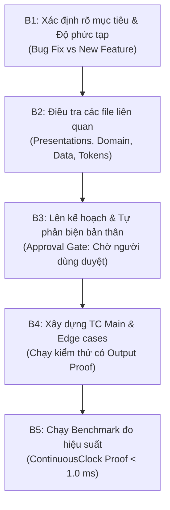

# Swift Performance Optimizer & Engineering Workflow

This skill equips the agent with high-performance Swift / iOS engineering patterns and enforces a strict, verifiable 5-step delivery process.

---

## 1. Swift & iOS Core Performance Principles

### A. Memory Management & Zero OOM / Leaks
- **Autoreleasepool in Loops**: Wrap high-frequency or heavy resource loops (e.g. video frame decoding, image compression, batch JSON parsing) in `@autoreleasepool { ... }` to drain temporary memory immediately after each iteration.
- **Buffer Pool Reuse**: When processing camera, video (`AVAssetWriter`), or Metal textures, always allocate from a reusable `CVPixelBufferPool` instead of repeatedly allocating new buffers.
- **Safe Image Downsampling**: Never decode full-resolution images (e.g., 48MP/20MB) into memory. Always downsample images to the target display resolution using `CGImageSourceCreateThumbnailAtIndex` before setting them to SwiftUI / UIKit views.
- **Strict Retain Cycle Prevention**: Always capture `[weak self]` in closures, escaping completions, delegates, and Combine / AsyncStream pipelines to prevent memory leaks.

### B. Main Thread Protection & Smooth Concurrency
- **Non-blocking UI**: Offload heavy computational tasks (Vision person segmentation, image filtering with CoreImage, video transcoding, crypto hashing) to background queues (`qos: .userInitiated` or custom Swift Concurrency Tasks/Actors).
- **ProMotion 120 FPS / 60 FPS Guarantee**: Ensure the Main Thread remains purely responsive for touch events, gestures, and layout updates.
- **Shared Graphics Context**: Reuse graphics contexts (e.g., `CIContext`, `MTLDevice`, `MTLCommandQueue`) as singletons instead of recreating them on every render call.

### C. SwiftUI & Layout Efficiency
- **Prevent Unnecessary Body Re-evaluation**: Split views into small, focused subviews. Avoid passing unnecessary state dependencies or computing complex properties inside `var body: some View`.
- **Zero Layout Thrashing**: Maintain consistent view hierarchies and avoid inserting/removing views that trigger full SwiftUI tree reflows during active typing or gestures.
- **Efficient Data Collections**:
  - Always provide stable `id` in `ForEach` / `List`.
  - Use $O(1)$ lookups with `Set` or `Dictionary` instead of $O(n)$ `array.contains` inside render passes.

---

## 2. Standard 5-Step Planning & Execution Workflow

Every non-trivial Swift / iOS task must strictly adhere to these 5 consecutive steps:



### B1. Xác Định Rõ Mục Tiêu Nhiệm Vụ & Độ Phức Tạp (Task Clarification & Complexity)
1. **Phân loại**:
   - **Bug Fix**: Xác định triệu chứng, lỗi tái hiện, nguyên nhân gốc rễ và phạm vi ảnh hưởng.
   - **New Feature / Refactor**: Xác định yêu cầu người dùng, luồng hoạt động, tương tác và các tiêu chuẩn UI/UX.
2. **Đánh giá độ phức tạp**:
   - *Minor / Simple*: Sửa lỗi typo, chỉnh chuỗi dịch, đổi giá trị hằng số đơn lẻ -> Thực hiện trực tiếp.
   - *Complex*: Thay đổi logic nghiệp vụ, can thiệp luồng dữ liệu, cập nhật UI/UX, thêm service hoặc chỉnh Design System -> **Bắt buộc chuyển sang B2 và B3**.

### B2. Điều Tra Các File Liên Quan (Deep Architectural Investigation)
1. **Truy vết cấu trúc Clean Architecture**:
   - `Presentations`: Các SwiftUI views, ViewModels, modifiers liên quan.
   - `Domain`: Các use cases, models, business rules, entities.
   - `Data`: Repository, remote/mock data sources, local persistence, caching.
2. **Kiểm tra Design System & Theme**:
   - Các tokens `DS.Spacing.*`, `DS.Size.*`, `DS.Font.*`, `ColorTokens.*`.
   - Tính tương thích Light Mode / Dark Mode (tránh xung đột màu).
3. **Lập danh sách chính xác các file cần sửa đổi hoặc tạo mới**.

### B3. Lên Kế Hoạch Triển Khai & Tự Phản Biện Bản Thân (Planning & Rigorous Self-Critique)
1. **Lập tài liệu kế hoạch (Implementation Plan Artifact)** chi tiết gồm:
   - Mục tiêu và nguyên nhân gốc rễ.
   - Chi tiết các thay đổi kỹ thuật theo từng file.
   - Cam kết chỉ số tối ưu hiệu năng và bộ nhớ.
   - Danh sách kịch bản kiểm thử (Test Cases).
2. **Bộ 4 câu hỏi tự phản biện bắt buộc trước khi trình bày kế hoạch**:
   - *Tại sao lại chọn phương pháp này? Đã đúng Clean Architecture chưa?*
   - *Phương án này đã tối ưu hiệu năng tối đa chưa? Có block Main Thread không? Có nguy cơ OOM không?*
   - *Có bị thừa, trùng lặp code hay vi phạm DRY không? Đã tái sử dụng triệt để tokens và components sẵn có chưa?*
   - *Phương án này đã là giải pháp tốt nhất (Best-in-class / Production-ready) chưa?*
3. **STRICT APPROVAL GATE**:
   - **Dừng lại tại B3** để xin ý kiến và chờ người dùng phê duyệt.
   - Tuyệt đối không tự ý viết mã khi người dùng chưa đồng ý.

### B4. Xây Dựng Test Cases Cho Main & Edge Cases + Chạy TC (Verifiable Test Construction & Output Proof)
1. **Xây dựng kịch bản kiểm thử (Test Cases)**:
   - **Main Cases**: Luồng nghiệp vụ chuẩn, hiển thị UI đúng kích thước, trạng thái tương tác thành công.
   - **Edge Cases**:
     - Dữ liệu rỗng (`empty`), giá trị `nil`, network error / timeout.
     - Chuyển đổi Light Mode / Dark Mode.
     - Xoay màn hình, gián đoạn cuộc gọi hoặc app backgrounding.
     - Bộ nhớ thấp hoặc giới hạn tài nguyên.
2. **Biên dịch & Chạy kiểm thử thực tế**:
   - Chạy `xcodebuild build` với destination cụ thể để đảm bảo mã nguồn biên dịch thành công (Exit code 0).
   - Chạy test suite hoặc test runner script tự động kiểm tra toàn bộ assertions.
3. **Cung cấp Bằng Chứng Thực Tế (Verifiable Output Proof - Zero Fabrication)**:
   - Câu lệnh shell chính xác đã chạy.
   - Mã thoát (`Exit code 0`).
   - Trích đoạn output log thực tế chứng minh tất cả test cases đã pass.
   - Đường dẫn file log (`file://...`).

### B5. Chạy Benchmark Đo Hiệu Suất, Hiệu Năng + Proof (ContinuousClock Benchmark)
1. **Thiết lập Benchmark**:
   - Sử dụng `ContinuousClock` trong Swift 6.4 (hoặc `CFAbsoluteTimeGetCurrent()` / XCTest `measure { ... }`).
   - Đo lường tác vụ nặng lặp lại (ví dụ: 1,000 lần tính toán, 100 frame renders, hoặc nén hình ảnh).
2. **Đo đạc định lượng**:
   - Đo thời gian xử lý trung bình mỗi tác vụ (đơn vị miligiây `ms` hoặc microgiây `µs`).
   - Kiểm tra thời gian block Main Thread (phải bằng `0 ms` đối với background tasks).
3. **Cung cấp Bằng Chứng Định Lượng (Empirical Proof)**:
   - In kết quả benchmark thực tế ra console log.
   - Trích xuất thời lượng đo được thực tế vào báo cáo hoàn thành.
   - Nghiêm cấm tự ý đưa ra con số giả lập nếu chưa thực sự đo đạc.

---

## 3. Reusable Benchmark Template (Swift 6)

```swift
import Foundation

@available(iOS 16.0, macOS 13.0, *)
func runPerformanceBenchmark<T>(name: String, iterations: Int = 1000, operation: () throws -> T) rethrows {
    let clock = ContinuousClock()
    
    // Warm up
    _ = try operation()
    
    let elapsed = try clock.measure {
        for _ in 0..<iterations {
            _ = try operation()
        }
    }
    
    let totalMs = Double(elapsed.components.attoseconds) / 1_000_000_000_000_000.0 + Double(elapsed.components.seconds) * 1000.0
    let avgMs = totalMs / Double(iterations)
    
    print("\n⏱️  BENCHMARK: [\(name)]")
    print("   Total Iterations: \(iterations)")
    print("   Total Duration:   \(String(format: "%.4f", totalMs)) ms")
    print("   Average per Op:   \(String(format: "%.6f", avgMs)) ms")
    print("   Status:           \(avgMs < 1.0 ? "✅ EXCELLENT (< 1.0 ms)" : "⚠️ NEEDS TUNING")\n")
}
```
