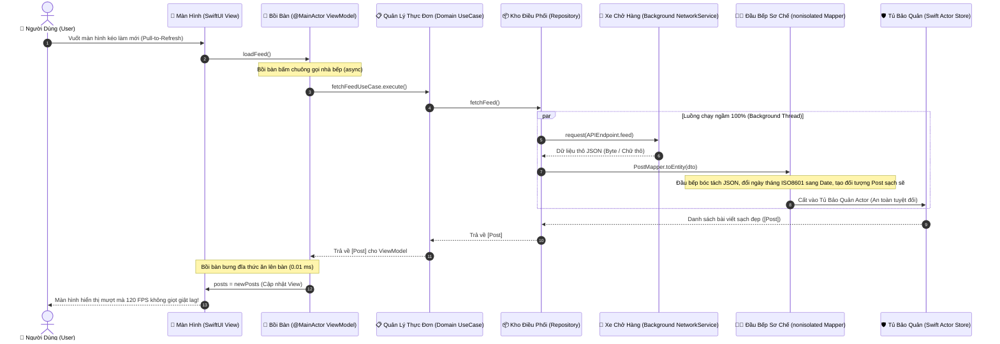

# Cẩm Nang Toàn Diện: Luồng Parse Dữ Liệu & Đa Luồng (Threading) Cho Người Non-Tech
## Dành riêng cho Dự Án Instagram iOS (Swift 6 & Modern Concurrency)

> **Mục tiêu tài liệu**: Giúp bất kỳ ai — dù chưa từng viết một dòng code nào — cũng có thể hiểu tường tận:
> 1. Tại sao ứng dụng điện thoại đôi khi bị giật, lag hoặc "đơ" màn hình?
> 2. Đa luồng (Threading) là gì và tại sao chiếc iPhone lại cần phân chia nhiều luồng công việc?
> 3. Dữ liệu từ Internet (dạng thô) được biến đổi thành những bức ảnh, bài viết Instagram lung linh trên màn hình như thế nào?
> 4. `Swift Actor`, `MainActor`, `Background Thread` đóng vai trò gì giống như một nhà hàng 5 sao cao cấp?

---

## 1. Ẩn Dụ Thực Tế: "Nhà Hàng 5 Sao Instagram"

Để dễ hình dung kiến trúc phần mềm, hãy tưởng tượng ứng dụng Instagram trên điện thoại của bạn hoạt động chính xác như một **Nhà hàng ẩm thực 5 sao tiêu chuẩn quốc tế**:

```
┌────────────────────────────────────────────────────────────────────────────────────────┐
│                               NHÀ HÀNG 5 SAO INSTAGRAM                                 │
├────────────────────────────────────────────────────────────────────────────────────────┤
│                                                                                        │
│  [ KHÁCH HÀNG ] (User)                                                                 │
│         │                                                                              │
│         ▼ (Chạm màn hình, vuốt lướt xem ảnh)                                           │
│  [ ANH BỒI BÀN TRƯỞNG ]  =======>  ĐẠI DIỆN CHO: [ MAIN THREAD / @MainActor ]          │
│   • Luôn túc trực tại bàn                                                              │
│   • Nụ cười rạng rỡ, phục vụ cực nhanh (chỉ được chớp mắt 8.33 phần nghìn giây!)      │
│   • Nhiệm vụ duy nhất: Giao tiếp với khách & bưng đĩa món ăn đẹp mắt đặt lên bàn.     │
│   • TUYỆT ĐỐI KHÔNG ĐƯỢC CHẠY XUỐNG BẾP ĐỂ CHẶT THỊT, NHẶT RAU!                       │
│         │                                                                              │
│         ▼ (Bấm chuông gọi món / await)                                                 │
│  [ CỬA SỔ QUẦY TRẢ MÓN ] =======>  ĐẠI DIỆN CHO: [ SWIFT ACTOR ]                       │
│   • Cửa sổ chỉ mở cho 1 người lấy đĩa một lúc (Loại trừ 100% tranh chấp / Data Race)   │
│   • Đảm bảo đồ ăn ra đúng thứ tự, không bao giờ bị rơi vãi hay lẫn lộn                  │
│         │                                                                              │
│         ▼ (Phân chia công việc ngầm)                                                   │
│  [ ĐỘI NGŨ ĐẦU BẾP NGẦM ] ======>  ĐẠI DIỆN CHO: [ BACKGROUND THREADS ]                │
│   • Nằm hoàn toàn sau cánh cửa cách âm, khách hàng không hề nhìn thấy                  │
│   • Nhận nguyên liệu thô từ xe chở hàng (Dữ liệu JSON từ Server Internet)             │
│   • Gọt vỏ, chặt thịt, đun nấu, trang trí tinh tươm (Parse DTO -> Clean Model Entity)  │
│   • Nấu xong mới đặt lên Quầy Trả Món (Actor) cho Bồi bàn bưng ra                      │
│                                                                                        │
└────────────────────────────────────────────────────────────────────────────────────────┘
```

---

## 2. Vì Sao Ứng Dụng Bị "Giật, Đơ" Màn Hình? (Khái Niệm Frame Budget)

### 2.1 Cuốn Sổ Vẽ Chuyển Động (Flipbook)
Màn hình điện thoại hiển thị chuyển động giống như bạn lật một cuốn sổ tay vẽ hoạt hình:
- Trên màn hình chuẩn (60 Hz): Cần lật **60 bức tranh mỗi giây** (Mỗi bức tranh phải vẽ xong trong **16.6 mili-giây**).
- Trên màn hình ProMotion xịn sò của iPhone 16 Pro (120 Hz): Cần lật **120 bức tranh mỗi giây** (Mỗi bức tranh phải vẽ xong trong vỏn vẹn **8.33 mili-giây** - nhanh gấp 40 lần một cái chớp mắt của con người!).

### 2.2 Sai Lầm Chết Người: Để Bồi Bàn Đi Nấu Ăn
- **Main Thread** chính là anh chàng Bồi bàn chịu trách nhiệm vẽ các bức tranh đó.
- Nếu bạn bắt Bồi bàn: *"Này anh, có một kiện hàng 10.000 ký tự chữ cái (JSON từ máy chủ) mới về, anh đứng trước mặt khách giải mã và tính toán ngày giờ hộ tôi!"*.
- Bồi bàn cặm cụi bóc kiện hàng mất **50 mili-giây**.
- Hậu quả: Bồi bàn bỏ lỡ mất 6 khung hình liên tiếp! Thực khách vuốt màn hình thấy bị khựng lại, giật cục (drop frame). Nếu Bồi bàn bận quá 5 giây, hệ điều hành iOS sẽ nghĩ app bị đơ và tự động "bắn hạ" (Crash/Kill app).

> 💡 **Quy Tắc Sống Còn của Instagram iOS**:
> **Main Thread CHỈ LÀM VIỆC CỦA BỒI BÀN**: Vẽ giao diện và nhận cảm ứng ngón tay.
> Toàn bộ việc bóc hàng, tính toán, biến đổi dữ liệu **100% PHẢI CHUYỂN RA NHÀ BẾP (Background Threads)**!

---

## 3. Bản Đồ Hành Trình Của Một Bài Viết (Từ Server Đến Mắt Người Dùng)

Dưới đây là sơ đồ chi tiết từng bước mà một bài viết Instagram trải qua:



---

## 4. Giải Thích Các Khái Niệm Kỹ Thuật Bằng Hình Ảnh

### 4.1 Swift Actor — "Chiếc Hòm Thư Độc Quyền"
- **Vấn đề (Data Race)**: Khi hai người dùng cùng bấm nút "Thích" và "Lưu bài viết" trong cùng 1 mili-giây. Nếu hai luồng cùng lao vào sửa một mẩu giấy dữ liệu, nét mực sẽ đè lên nhau, giấy bị rách và ứng dụng bị văng (Crash).
- **Giải pháp Swift Actor**: Giống như một chiếc hòm thư thông minh hoặc quầy giao dịch 1 cửa.
  - Ai đến trước được phục vụ trước.
  - Người đến sau sẽ tự động đứng vào hàng đợi trật tự (`await`).
  - Không bao giờ có chuyện 2 người cùng cầm chung một cây bút để sửa dữ liệu!

### 4.2 nonisolated Mappers — "Bàn Sơ Chế Tự Do Ngoài Vườn"
- `PostMapper`, `CommentMapper`, `UserMapper` được gán nhãn `nonisolated`.
- Nghĩa là: Bất kỳ đầu bếp phụ nào, ở bất kỳ góc bếp nào cũng có thể nhặt nguyên liệu vào bàn này để sơ chế (biến đổi từ DTO sang Model Entity) mà không cần xin phép Bồi bàn, không chiếm dụng tài nguyên của ai.

### 4.3 DTO (Data Transfer Object) vs Entity (Domain Model)
- **DTO**: Giống như **Thùng hàng đóng gói nguyên kiện từ nhà máy** gửi về (còn nguyên băng keo, mã vạch, chữ viết tắt như `"created_at": "2026-10-16T08:00:00Z"`).
- **Entity**: Giống như **Món ăn đã được trình bày lên đĩa sứ sang trọng**, rau củ đã rửa sạch, thịt đã nướng thơm lừng, ngày tháng đã chuyển thành định dạng chuẩn để sẵn sàng thưởng thức ngay.

---

## 5. Bảng Đối Chiếu Thuật Ngữ (Dành Cho Người Mới)

| Thuật Ngữ Kỹ Thuật | Ẩn Dụ Đời Thường | Vai Trò Trong Ứng Dụng |
| :--- | :--- | :--- |
| **Main Thread (`@MainActor`)** | Bồi bàn trưởng tại sảnh chính | Chỉ lo đón khách, vẽ hình lên màn hình, bắt chạm ngón tay. |
| **Background Thread** | Căn bếp cách âm phía sau | Tải dữ liệu mạng, giải mã file nặng, tính toán phức tạp. |
| **Swift Actor** | Quầy trả món một cửa | Bảo vệ dữ liệu không bị sửa đổi lung tung khi nhiều nơi cùng gọi. |
| **JSON Decoding** | Bóc băng keo thùng hàng | Chuyển đổi dãy ký tự máy tính nhận từ Internet thành đối tượng Swift. |
| **Mapper (`nonisolated`)** | Thớt sơ chế nguyên liệu | Chuyển dữ liệu mạng thô (DTO) thành dữ liệu ứng dụng sạch (Entity). |
| **Frame Drop / Giật Lag** | Khách gọi nước mà bồi bàn đứng hình | Do bồi bàn mải tính tiền hoặc nhặt rau quá 8.33 mili-giây. |
| **120 FPS ProMotion** | Cuốn sổ vẽ tranh lật siêu tốc | Mang lại cảm giác vuốt chạm dính tay, mượt mà như bơ. |

---

## 6. Lời Kết Về Tiêu Chuẩn Hiệu Năng 5 Sao Của Instagram

Nhờ kiến trúc phân luồng chặt chẽ:
1. **0 mili-giây bị chặn trên Main Thread**: Bồi bàn luôn sẵn sàng 100% phục vụ ngón tay của bạn.
2. **Loại bỏ 100% Data Race**: Mọi kho dữ liệu (PostStore, MessageStore, UserStore) đều được bảo vệ bằng Swift `actor`.
3. **Mã nguồn sạch, chuẩn Swift 6**: Không có warning, không có crash ngầm, tốc độ phản hồi cực nhanh.
