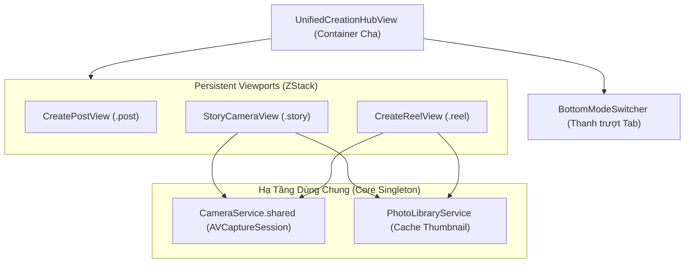
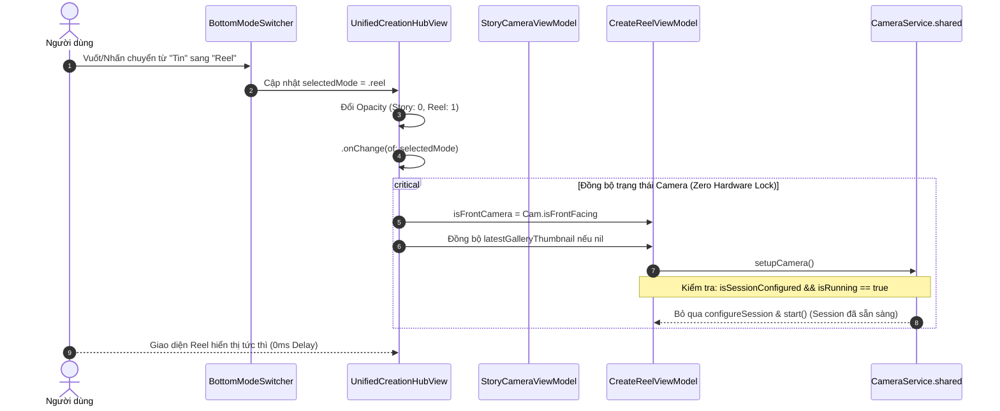

# Kiến Trúc & Luồng Hoạt Động Giữa Tab "Tin" (Story) Và "Reel" (Reel)

Tài liệu này mô tả chi tiết kiến trúc, vòng đời hiển thị (viewport lifecycle), luồng phần cứng camera và cơ chế đồng bộ dữ liệu giữa hai chế độ tạo nội dung **Tin (Story)** và **Reel (Reel)** trong trung tâm sáng tạo tập trung (**Unified Creation Hub**).

---

## 1. Tổng Quan Kiến Trúc (Architecture Overview)

Dự án áp dụng mô hình **Clean Architecture**:
- **Presentation Layer**: 
  - [`UnifiedCreationHubView.swift`](file:///Users/tomthecat/temp/Presentations/CreatePost/CreationHub/UnifiedCreationHubView.swift): Container cha quản lý điều hướng giữa 3 chế độ (Bài viết, Tin, Reel).
  - [`StoryCameraView.swift`](file:///Users/tomthecat/temp/Presentations/StoryCamera/StoryCameraView.swift): Giao diện chụp ảnh, quay video ngắn và soạn thảo Tin.
  - [`CreateReelView.swift`](file:///Users/tomthecat/temp/Presentations/CreateReel/CreateReelView.swift): Giao diện quay video đa phân đoạn (multi-segment), căn chỉnh Ghost frame, hẹn giờ và biên tập Reel.
- **Core Infrastructure Layer**:
  - [`CameraService.swift`](file:///Users/tomthecat/temp/Core/Camera/CameraService.swift): Singleton cấp ứng dụng quản lý `AVCaptureSession`, kết nối thiết bị cảm biến và pipeline render Metal/AVFoundation.
  - [`CameraPreviewView.swift`](file:///Users/tomthecat/temp/Presentations/StoryCamera/CameraPreviewView.swift): `UIViewRepresentable` bao bọc `AVCaptureVideoPreviewLayer`.



---

## 2. Cơ Chế Viewport Bền Vững (Persistent Mode Viewports)

### A. Vấn đề trước khi tối ưu
Trước đây, `UnifiedCreationHubView` sử dụng cấu trúc `switch selectedMode` kết hợp tiêu hủy hoàn toàn view cũ và tạo mới view mới mỗi khi người dùng vuốt đổi tab. Điều này dẫn đến:
1. `AVCaptureVideoPreviewLayer` bị ngắt kết nối (detach) và gắn lại (re-attach) liên tục vào `AVCaptureSession`.
2. CoreMedia phải flush toàn bộ buffer video, gây chớp đen hoặc giật lag 200–400ms trên Main Thread.
3. Toàn bộ cây view (~1.000 dòng code mỗi màn) phải re-layout từ đầu.

### B. Giải pháp Viewport Bền Vững (Persistent Viewport Pattern)
Cả `StoryCameraView` và `CreateReelView` được **khởi tạo và duy trì đồng thời trong cùng một `ZStack`**:

```swift
ZStack {
    // 1. Chế độ Thư viện Post (nằm trên cùng nếu kích hoạt)
    if selectedMode == .post {
        CreatePostView(viewModel: postViewModel)
            .zIndex(2)
            .transition(.opacity)
    }

    // 2. Chế độ Camera Bền Vững (Story & Reel)
    ZStack {
        StoryCameraView(viewModel: storyViewModel, stopCameraOnDisappear: false)
            .opacity(selectedMode == .story ? 1 : 0)
            .allowsHitTesting(selectedMode == .story)
            .accessibilityHidden(selectedMode != .story)

        CreateReelView(viewModel: reelViewModel, stopCameraOnDisappear: false)
            .opacity(selectedMode == .reel ? 1 : 0)
            .allowsHitTesting(selectedMode == .reel)
            .accessibilityHidden(selectedMode != .reel)
    }
    .zIndex(1)
}
```

### C. Lợi thế hiệu năng:
- **Zero View Destruction**: Không tiêu hủy và cấp phát mới bộ nhớ khi chuyển tab.
- **Continuous Camera Stream**: Stream video từ cảm biến camera chạy liên tục không bị gián đoạn.
- **Zero Layout Thrashing**: Chỉ thay đổi thuộc tính `opacity` và `allowsHitTesting`, duy trì tần số quét 60/120 FPS ProMotion mượt mà.

---

## 3. Luồng Quản Lý Phần Cứng Camera (Camera Hardware Flow)

### A. Sơ đồ tuần tự khi chuyển tab (Sequence Diagram)



### B. Cơ chế Hot-swap & Tái Sử Dụng Session (Session Reuse)
Trong [`CreateReelViewModel.swift`](file:///Users/tomthecat/temp/Presentations/CreateReel/CreateReelViewModel.swift) và [`StoryCameraViewModel.swift`](file:///Users/tomthecat/temp/Presentations/StoryCamera/StoryCameraViewModel.swift):

```swift
func setupCamera() async {
    if cameraService.isSessionConfigured {
        isFrontCamera = cameraService.isFrontFacing
        if cameraService.isRunning {
            // Camera session đã chạy sẵn từ tab trước;
            // BỎ QUA việc gọi configureSession() để không block sessionQueue
            await loadLatestGalleryThumbnail()
            return
        }
    }
    _ = await cameraService.configureSession(isFront: isFrontCamera)
    cameraService.start()
    await loadLatestGalleryThumbnail()
}
```

### C. Quản lý năng lượng & Tiết kiệm Pin (Power Capping)
Khi người dùng chuyển sang tab **Bài viết (`.post`)**:
- Camera phần cứng không cần thiết cho việc chọn ảnh thư viện.
- `UnifiedCreationHubView.onChange` gọi ngay `CameraService.shared.stop()` để ngắt cảm biến camera, tiết kiệm pin và giảm nhiệt độ thiết bị.
- Khi người dùng chuyển lại tab **Tin (`.story`)** hoặc **Reel (`.reel`)**, `CameraService.shared.start()` được kích hoạt trở lại.

---

## 4. Cơ Chế Đồng Bộ Trạng Thái & Bộ Nhớ Đệm (State & Cache Synchronization)

### A. Đồng bộ chiều xoay Camera (`isFrontFacing`)
Khi người dùng lật camera trước/sau ở Story rồi chuyển sang Reel (hoặc ngược lại):
- `CameraService.shared.isFrontFacing` giữ trạng thái cảm biến thực tế.
- Trong `onChange(of: selectedMode)` của Hub:
  ```swift
  if newMode == .reel {
      reelViewModel.isFrontCamera = CameraService.shared.isFrontFacing
  } else if newMode == .story {
      storyViewModel.isFrontCamera = CameraService.shared.isFrontFacing
  }
  ```
  Điều này đảm bảo UI icon lật camera trên cả hai màn hình luôn đồng nhất 100% với trạng thái phần cứng mà không cần re-configure.

### B. Chia sẻ bộ nhớ đệm Thumbnail thư viện (`latestGalleryThumbnail`)
Để tránh việc cả hai ViewModel cùng gọi IPC nặng đến dịch vụ `assetsd` (`PHPhotoLibrary`):
- Khi một trong hai ViewModel đã tải xong thumbnail 80x80px từ thư viện ảnh:
  ```swift
  if newMode == .reel && reelViewModel.latestGalleryThumbnail == nil {
      reelViewModel.latestGalleryThumbnail = storyViewModel.latestGalleryThumbnail
  } else if newMode == .story && storyViewModel.latestGalleryThumbnail == nil {
      storyViewModel.latestGalleryThumbnail = reelViewModel.latestGalleryThumbnail
  }
  ```
- Nhờ vậy, thao tác chuyển tab không phát sinh bất kỳ Disk I/O hay IPC nào.

### C. Cách ly dữ liệu tạo tác (Artifact Isolation)
Mặc dù dùng chung Camera stream, dữ liệu nội dung của từng chế độ hoàn toàn độc lập:
- **Story State**: Quản lý ảnh tĩnh đã chụp, video ngắn, sticker PIP, văn bản canvas.
- **Reel State**: Quản lý mảng các đoạn clip đã quay (`recordedClips`), thời lượng tối đa (15s, 30s, 60s, 90s), tốc độ (0.3x đến 3x), âm thanh đã chọn.

---

## 5. Quy Tắc Hiển Thị Thanh Chuyển Chế Độ (Bottom Mode Switcher Visibility)

Thanh trượt chuyển đổi chế độ (`bottomModeSwitcher`) chỉ được phép hiển thị khi người dùng đang ở màn hình ngắm chụp ban đầu. Thanh trượt tự động ẩn đi bằng animation khi người dùng tiến vào các bước sâu hơn:

```swift
private var shouldShowModeSwitcher: Bool {
    switch selectedMode {
    case .post:
        return postViewModel.currentStep == .selectMedia
    case .story:
        return !storyViewModel.isShowingPreview && !storyViewModel.hasCapturedMedia
    case .reel:
        return !reelViewModel.isRecording && !reelViewModel.isShowingEditor && !reelViewModel.isShowingShareDetails
    }
}
```

- **Khi đang quay video hoặc đếm ngược (Countdown/Recording)**: Ẩn thanh chuyển chế độ.
- **Khi ở màn hình Story Editor / Reel Trimmer**: Ẩn thanh chuyển chế độ để nhường không gian cho các công cụ biên tập.
- **Khi hủy bỏ (Retake) hoặc quay lại màn hình ngắm chụp**: Thanh chuyển chế độ trượt lên lại với spring animation.

---

## 6. Bảng Tóm Tắt So Sánh & Chỉ Số Kỹ Thuật

| Hạng mục | Trước khi tối ưu | Sau khi tối ưu (Kiến trúc hiện tại) |
| :--- | :--- | :--- |
| **Cơ chế Viewport** | Hủy & tạo lại View struct (`switch`) | Persistent `ZStack` (`opacity` + `allowsHitTesting`) |
| **Pipeline CoreMedia** | Detach/Re-attach Preview Layer mỗi lần đổi tab | Giữ nguyên preview layer, CoreAnimation tối ưu tự động |
| **Cấu hình phần cứng** | Khóa `sessionQueue` cấu hình lại camera | Bỏ qua nếu session đang chạy (Hot reuse) |
| **Truy vấn Photo Library** | Gọi lại `loadLatestGalleryThumbnail` nhiều lần | Cache 1 lần, đồng bộ 2 chiều qua Hub |
| **Khung hình hiển thị** | Drop frame (giật khựng 200–400ms) | Chuyển đổi tức thì (ProMotion 60/120 FPS) |
| **Tiêu thụ pin khi xem Post** | Không ngắt camera | Tự động gọi `CameraService.stop()` ngắt cảm biến |
